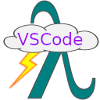
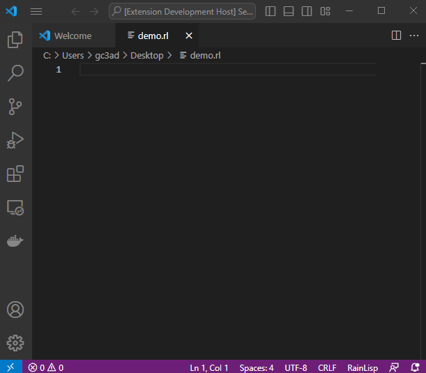

# RainLisp VSCode

[](https://marketplace.visualstudio.com/items?itemName=chr1st0scli.rainlisp-vscode)
[](LICENSE.txt)



VSCode extension for [RainLisp](https://github.com/chr1st0scli/RainLisp) support.

## Features

This extension offers syntax highlighting, code completion, code snippets, procedure signature help, mouse hover information, a theme and integration with RainLisp's interpreter.



In order to get started with RainLisp, you can visit its [repository](https://github.com/chr1st0scli/RainLisp),
where you can find a [tutorial](https://github.com/chr1st0scli/RainLisp/blob/master/RainLisp/Docs/quick-start.md) and other material.

## Requirements

If you want to run RainLisp code and not just write it, you need to download the interpreter, [RainLisp Console](https://github.com/chr1st0scli/RainLispConsole).

In order to download RainLispConsole from NuGet and install it as a global tool, run the command `dotnet --list-runtimes` to determine the corresponding command you need to run.

|.NET Runtime|Command|
|------------|-------|
|6|dotnet tool install -g RainLispConsole --version 1.4.0|
|8|dotnet tool install -g RainLispConsole --version 2.0.0|
|10|dotnet tool install -g RainLispConsole|

If you already have the latest version installed and you want to update it, run the following command.

```
dotnet tool update -g RainLispConsole
```

Once installed, you can hit Ctrl + F12, or cmd + F12 for MacOS, while working with a RainLisp file (*.rl), to run the code.
